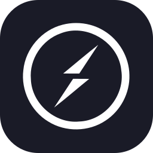

  

  
  
  
  

  <i>“ Ngoding serius, debugging playful — ship fast, learn faster 🎮 ”</i>

---

## 🙋‍♂️ About Me

> Associate Degree student in Informatics Engineering at **Politeknik Negeri Jember**, focused on building efficient, scalable web applications, IoT integration, and modern system design.

- 🚀 **Currently developing:** **NCH — School Management System**, a three-tier ecosystem (Laravel REST API, React admin panel, Flutter mobile app)
- 🧪 **Research & experimentation:** ESP32-based sensor fusion (pH/PPM/temperature) with MQTT/WebSocket telemetry, plus early computer vision using HOG + SVM
- 🛠️ **Technical focus:** Laravel ecosystem, REST API design, containerized deployment, and CI/CD pipelines
- 📈 **Continuous learning:** Advanced fullstack engineering and DevOps fundamentals
- 💼 **Open to:** Junior Developer and Technology Internship opportunities

---

## 💻 Tech Stack & Tools

  
  
  
  
  
  
  
  
  
  
  
  
  
  
  
  
  
  
  
  
  
  
  
  
  
  
  
  

<!-- ponytail: skillicons tak punya slug esp32/mqtt/websocket, jadi tiap icon jadi  48px inline agar semua sejajar & wrap rapi -->

---

## 🛠️ Featured Projects

<!-- ponytail: tambah screenshot/GIF when ada — ganti emoji cell dengan  -->

| Project | Stack | Highlight |
|---|---|---|
| 🌐 **[NgelayapJatim](https://github.com/Fodly18/pokok_yakin_wes)** — Travel & Tourism GIS | `PHP/Laravel` `JS` `Maps API` `MySQL` | Interactive route tracking + multi-category search untuk wisata Jatim |
| 🌿 **[SmartCoy](https://github.com/Fodly18/web_monitoring_agro)** — IoT Hydroponic + AI | `Laravel` `JS` `Bootstrap` `Python` `C++` `ESP32` `MQTT` `MySQL` | Realtime dashboard pH/PPM/temp + HOG & SVM leaf disease early model |
| 🛒 **[GoLapak](https://github.com/HiragiIsMe/golapak-web)** — UMKM Digitalization | `Laravel` `JS` `MySQL` `Bootstrap` | 100% responsive + RESTful API sinkron web ↔ mobile |
| 📚 **[Edu-Learn](https://github.com/Fodly18/Nekolympus_S3)** — LMS SDN 1 Kalisat | `PHP/MVC` `JS` `MySQL` `Bootstrap` | Lead System Architect — grading + material management end-to-end |
| 🏫 **NCH (Nurul Chotib)** — School Management System 🔒 | `Laravel 12` `Octane` `React 19` `TypeScript` `Flutter` `MariaDB` `Redis` `Firebase FCM` | Ekosistem 3 repo: REST API + Web Admin + Mobile (Guru/Santri/Security), absensi geofence & push realtime, deploy CI/CD otomatis |

---

## 📊 GitHub Analytics & Animations

  

  

  

### 🕹️ Pac-Man Contribution Adventure

  <picture>
    <source media="(prefers-color-scheme: dark)" srcset="https://raw.githubusercontent.com/Fodly18/Fodly18/output/pacman-contribution-graph-dark.svg">
    <source media="(prefers-color-scheme: light)" srcset="https://raw.githubusercontent.com/Fodly18/Fodly18/output/pacman-contribution-graph.svg">
    
  </picture>

---

## 🤝 Let's Connect!

  <i>Tertarik kolaborasi, ngobrol soal web/IoT, atau punya peluang magang/kerja? Reach me out! 👇</i>

  
  
  
  

  

---

